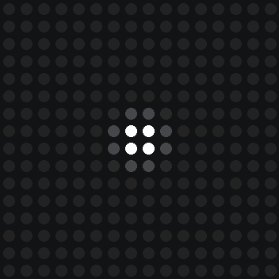

# Muon-test: LED cover opacity test

`ring_test.py` drops **muon ripples** into the centre of the muon detector's 16×16 NeoPixel
panel, animated exactly like the **Muon Ripple** artifact: a bright splash where the drop
lands, then a ring that spreads out and fades, like a drop in a lake. It's for judging a
3D-printed cover's opacity and diffusion with the real animation behind it:

- Do single LEDs show through as hotspots?
- Does the moving ring stay crisp, or smear into a glow?
- Do the dim tail of the ring and the fade-out still show through?



Every drop works the way it does in Muon Ripple:

- **Timing:** drops arrive at random times, 0.4 per second on average ("gallery pace").
  `--rate 1.7` gives the real sea-level muon rate.
- **Animation:** the ring spreads at 90 mm/s (9 LEDs per second), is 11 mm wide, and fades
  over about 1.6 s. It reaches the corners in about 1.2 s. The splash at the centre dies away
  in about 0.25 s.
- **Brightness and colour:** each drop gets a simulated muon energy. Most are 6–15 MeV, about
  9 MeV typical, and that sets how bright the drop is. About 7 % of drops are over 15.5 MeV
  and get the scheme's **rare** colour.
- **Gamma:** colours, fades and glitter are worked out in display units, as on the
  simulation page, and turned into LED drive levels with a 2.2 gamma, as the Muon Ripple
  board does. A fading ring dims the way it looks on the page instead of lingering at the
  bottom of the LEDs' range. Overlapping ripples add up before the gamma, as on the board.

By default the colour scheme changes on **every drop**: warm → cool → pride → warm … To run
just one scheme, use `--scheme warm`, `--scheme cool` or `--scheme pride`.

| Scheme | Typical | Rare |
|---|---|---|
| warm | `#dfe9ff` | `#ffb04a` |
| cool | `#6fd8ff` | `#b996ff` |
| pride | the next stripe: `#ff3b3b` `#ff9a1f` `#ffe733` `#2fd16a` `#3d7bff` `#b05cff` | a full rainbow round the ring |

Pride ripples also throw off white glitter where the ring passes, as in the artifact.

### 🩸 Blood: `--scheme bloody`

```bash
./quickstart.sh --scheme bloody
```

The artifact's fourth scheme. Every drop **splats** where it lands instead of rippling: a
lumpy blob with tapering spikes, droplets at some spike tips and a few stray satellites,
seeded from the drop so each one is its own shape.

- It's drawn in two colours, then projected onto the 16×16 grid: each LED shows the
  area-weighted mix of what falls in its 10 mm cell, in actual light. The **body** is pure
  red at drive 31. The **highlight**, the brightest colour, is pure red at drive 102: a small
  disc where a light up and to the north-west would catch the wet surface. Anything on the
  panel between the two is that blending, or the splat's partial coverage of a cell.
- **Fresh:** it lands as the ripple's 8 mm impact circle and spreads to the full splatter
  in 0.18 s, fast at first and then settling, then holds until 0.45 s.
- **Fading (0.45–3.05 s):** the whole splat fades out together on one smooth curve: a
  slight ease-in from the hold, then a gentle arc to black.
- It's pure red: the page's colours carry a touch of green and blue, which on the LEDs
  rounds to level 1 of 255 and shows in a dim room as a pink tint.
- Newer splats land on top of older ones, covering them where they overlap.
- Rare drops (over 15.5 MeV) splat bigger.
- Splats are mostly red, so they draw well under 1.5 A even at 1.7 drops/s.

### 🎃 Halloween: `--scheme pumpkin`

```bash
./quickstart.sh --scheme pumpkin
```

Every drop grows a **jack-o'-lantern** instead of a ripple. It starts as a small orange glow
at the centre, grows to fill the panel in 0.9 s, holds until 1.6 s, then fades out over
about 0.75 s. Drops
keep the same random timing as the ripples. The pumpkin is drawn LED-for-LED on the 16×16
grid, so at full size every LED is cleanly lit (orange body, green stem) or dark (carved
eyes and grin).


- Only one pumpkin shows at a time. When a new one lands, the old one fades out in about
  0.1 s, so the new pumpkin never grows over the old face and fills it in.
- Each pumpkin's brightness still comes from its muon energy, but it's capped at 1×.
  Brighter than that, the red channel clips and the orange turns yellow. Most drops land
  at full brightness.
- Each pumpkin's brightness is set when it lands, so the full-size pumpkin fits the power
  limit, and it then grows at that one steady brightness. It doesn't dim as it fills the
  panel. An orange pumpkin draws about 4 A at full size, so on a 4 A supply it runs at about
  85 %. The log shows it: `fitted to 85% for the power limit`.

#### Pumpkins in the ripple colours

```bash
./quickstart.sh --scheme pumpkin-warm     # or pumpkin-cool, pumpkin-pride
```

The same jack-o'-lantern, with its body coloured like that scheme's ripples. The stem stays
green.

| Scheme | Typical drop | Rare drop (over 15.5 MeV, about 7 %) |
|---|---|---|
| `pumpkin-warm` | white "ghost" pumpkin `#dfe9ff` | amber `#ffb04a` |
| `pumpkin-cool` | cyan `#6fd8ff` | purple `#b996ff` |
| `pumpkin-pride` | the next pride stripe on each drop | a full-rainbow jack-o'-lantern |

Pride pumpkins **sparkle** like the pride ripples: white glints, with a touch of the body
colour, twinkle across the body while it's lit. Rare (rainbow) pumpkins sparkle 1.5× as
much, as in the artifact.


White and cyan pumpkins light every colour channel, so they draw far more current: 6–7.6 A
at full size. On a 4 A supply they're fitted down to about 45–60 % brightness (pride ones to
about 50–85 %, keeping 15 % of the current free for the sparkles). A bigger supply and a
higher `--max-amps` will let them run brighter. On a green-stripe pride pumpkin, the green
stem blends into the body.

### ⚽ Soccer ball: `--scheme soccer`

```bash
./quickstart.sh --scheme soccer
```

The same grow-hold-fade as the pumpkins, but each drop is a **soccer ball**: white panels
with a dark pentagon in the middle, one at the top and two down each side. The ball is drawn
LED-for-LED on the grid with a one-LED white rim, so it stays round.


A white ball lights all three colour channels on 174 LEDs, about 10 A at full brightness.
So on a 4 A supply it's fitted to about 35 %, which is still bright white on the panel.

## Hardware

- Raspberry Pi 5
- Adafruit 16×16 NeoPixel matrix (WS2812B, GRB colour order, serpentine wiring)
- A separate **5 V 4 A** supply for the panel

| Panel wire | Connect to |
|---|---|
| DIN (data in) | Pi **GPIO18**, header **pin 12** |
| GND | 5 V supply **−** *and* a Pi GND pin (e.g. pin 6). The grounds **must** be shared. |
| 5V | 5 V supply **+**. **Not** the Pi's 5 V pin. |

Adafruit's recommended extras for a reliable panel:

- a 300–500 Ω resistor in series on the data line, close to the panel's DIN
- a 1000 µF capacitor across the panel's 5 V and GND
- a 74AHCT125 level shifter between GPIO18 and DIN. The Pi's data line is 3.3 V, while
  the panel at 5 V expects about 3.5 V as a logic high. It usually works without one,
  but if the panel flickers or shows wrong colours, add the level shifter first.

Power the Pi from its own USB-C supply.

## Quickstart

On the Pi, as your normal user (not `sudo`):

```bash
git clone https://github.com/imthinkingbee/Muon-test.git
cd Muon-test
./quickstart.sh
```

`quickstart.sh` checks and sets up everything below, then starts the test. It's safe to run
again: finished steps are skipped, so after the first time it goes straight to the test. It
asks before anything big, and uses `sudo` only for system changes.

1. Checks it's on a Raspberry Pi 5 with Python 3.11 or newer.
2. If `/dev/pio0` is missing, offers to update the OS, then asks you to reboot.
3. If you can't use `/dev/pio0`, adds a udev rule (`/etc/udev/rules.d/99-muon-pio.rules`) and
   puts you in the `gpio` group. You may need one reboot after this.
4. Creates the `.venv` virtual environment and installs the LED driver.
5. Runs `ring_test.py`.

If it stops and says reboot, reboot and run `./quickstart.sh` again.

Anything after `./quickstart.sh` is passed to the test, e.g. `./quickstart.sh --rate 1.7` or
`./quickstart.sh --brightness 0.25`. Use `./quickstart.sh --setup-only` to set up without running.

## Pi 5 setup by hand (what quickstart.sh does)

The Pi 5 can't use the old `rpi_ws281x` NeoPixel driver. This script uses Adafruit's Pi 5
driver instead, which drives the LEDs with the RP1 chip's PIO block.

1. Update the OS so the kernel and firmware have PIO support:
   ```bash
   sudo apt update && sudo apt full-upgrade -y
   sudo reboot
   ```
2. Check that the PIO device exists:
   ```bash
   ls -l /dev/pio0
   ```
   - If it's **not found**, the firmware or kernel is too old. Update again (step 1).
   - If it's owned by `root root`, let the `gpio` group use it, so the script doesn't need `sudo`:
     ```bash
     echo 'SUBSYSTEM=="*-pio", GROUP="gpio", MODE="0660"' | sudo tee /etc/udev/rules.d/99-muon-pio.rules
     sudo reboot
     ```
     Your user must be in the `gpio` group (the default user is). Check with `groups`.
3. Get the code and install the driver in a virtual environment. Raspberry Pi OS won't let
   you `pip install` into the system Python.
   ```bash
   git clone https://github.com/imthinkingbee/Muon-test.git
   cd Muon-test
   python3 -m venv .venv
   source .venv/bin/activate
   pip install -r requirements.txt
   ```

## Running

```bash
cd Muon-test
./quickstart.sh
```

or, after setup, directly:

```bash
cd Muon-test
source .venv/bin/activate
python3 ring_test.py
```

The script runs until **Ctrl+C**, which turns the panel off. Each drop is logged as it lands,
so you can match what you saw through the cover to the drop:

```
drop    1 | warm          | typical |   9.0 MeV | brightness x1.16
drop    2 | cool          | typical |   6.8 MeV | brightness x0.88
drop    3 | pride         | rare    |  17.2 MeV | brightness x1.60
```

| Option | Default | What it does |
|---|---|---|
| `--scheme S` | `rotate` | `rotate` = warm, cool, pride in turn. `warm`, `cool` or `pride` = only that scheme's ripples. `bloody` = blood splats that fade to black. `pumpkin` = orange jack-o'-lanterns. `pumpkin-warm`, `pumpkin-cool`, `pumpkin-pride` = jack-o'-lanterns in that scheme's colours. `soccer` = soccer balls. |
| `--rate R` | `0.4` | average drops per second, at random times. `1.7` = sea level. |
| `--brightness B` | `1.0` | overall brightness from 0 to 1 (e.g. `0.25`) |
| `--listen` | off | drop nothing on its own: each press of the space bar drops a muon, `r` drops a rare one. For watching one drop at a time. |
| `--fps F` | `60` | frames per second. The panel can take about 125; the exit log shows what the Pi managed. |
| `--gamma-test [COLOUR]` | off | a still test pattern for the gamma curve (see below). COLOUR: `red` (default), `green`, `blue`, `white` |
| `--duration S` | `0` | stop after *S* seconds (`0` = run until Ctrl+C) |
| `--seed N` | random | repeat exactly the same run of drops (handy for comparing two covers) |
| `--max-amps A` | `3.5` | panel current limit (see below) |
| `--pin N` | `18` | BCM GPIO number of the data line |
| `--layout` | `serpentine` | `progressive` if your panel's rows all run the same way |
| `--preview` | off | draw the panel in the terminal instead of driving LEDs. Works on any computer. |

Examples:

```bash
python3 ring_test.py --rate 1.7             # real sea-level muon rate
python3 ring_test.py --scheme cool          # only cool ripples (also: warm, pride)
python3 ring_test.py --scheme bloody        # blood splats that fade to black
python3 ring_test.py --scheme bloody --listen   # one splat per space bar press
python3 ring_test.py --scheme pumpkin       # jack-o'-lanterns 🎃
python3 ring_test.py --scheme pumpkin-pride # rainbow jack-o'-lanterns, with sparkles
python3 ring_test.py --scheme soccer        # soccer balls ⚽
python3 ring_test.py --brightness 0.25      # dimmer, to see when light stops getting through
python3 ring_test.py --seed 42              # same drops every time: swap covers and compare
python3 ring_test.py --preview              # try it out without the panel
```

### Gamma test

```bash
python3 ring_test.py --gamma-test          # or --gamma-test white
```

A still pattern of two snakes, each running along a row, down one, back along the next and
so on, with a blank row between lit rows (the turns light the blank rows' end LEDs). Each
fades from 100 % at its head (top left) to 0 at its tail:

- **Top snake:** straight in drive levels, 255 down to 0 evenly.
- **Bottom snake:** through the gamma curve the animations use (2.2), which should look
  evenly graded from head to tail if the curve suits the panel and cover.

`--brightness` scales both, as it does the animations.

### Brightness and the power limit

At full white, 256 NeoPixels can draw around 15 A, and a 4 A supply can't deliver that. The
script estimates each frame's current conservatively (20 mA per colour channel at full,
1 mA idle per LED) from the actual drive levels, after the gamma, and if a frame would go
over `--max-amps` (3.5 A, leaving headroom on a 4 A supply) it dims that frame just enough to
fit and logs `POWER-LIMITED` (at most once a second, and only for dips of 1 % or more).

- At the default 0.4 drops/s this doesn't happen: no frame was dimmed in a 2-minute run.
- At `--rate 1.7`, drops overlap more and about 1 frame in 100 gets dimmed a little, when
  several bright rings meet.
- Pumpkins and soccer balls don't lean on the limiter: each one's brightness is fitted when
  it lands (see the Halloween section). The limiter only nudges things by a fraction of a
  percent while one hands over to the next, and dips that small aren't logged.

If you use a bigger supply, raise `--max-amps` to about 90 % of its rating.

## Notes

- The ripples land between the four middle LEDs and spread symmetrically, so they look the
  same whichever corner the data enters and whichever way the rows run. (In the artifact, a
  drop lands wherever the muon hit. Here every drop lands in the centre.)
- Frames are sent at 60 per second by default (`--fps`), and
  each one takes a few milliseconds to work out. A splat's shape is worked out once as it
  lands, which takes a few milliseconds more.
- `--preview` undoes the gamma, so the terminal shows the panel as it looks, not its raw
  drive levels.
- On exit the script logs how many frames it sent and the rate it achieved. The panel itself
  can take about 125 frames a second: 256 LEDs × 24 bits at 800 kbit/s is 7.7 ms, plus the
  0.3 ms latch.
- Adafruit's Pi 5 NeoPixel examples use `byteorder="BGR"`. The driver sends bytes in buffer
  order, so for standard GRB NeoPixels that swaps red and blue. Their rainbow demos hide it.
  This script writes GRB directly.
